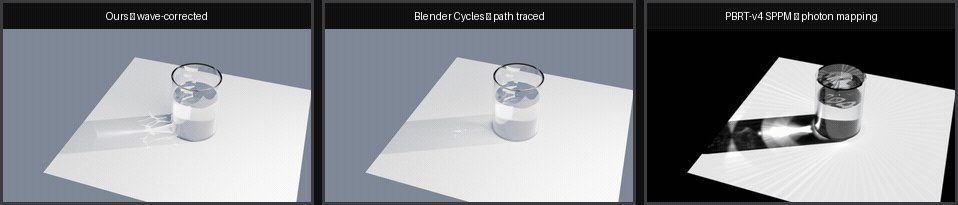
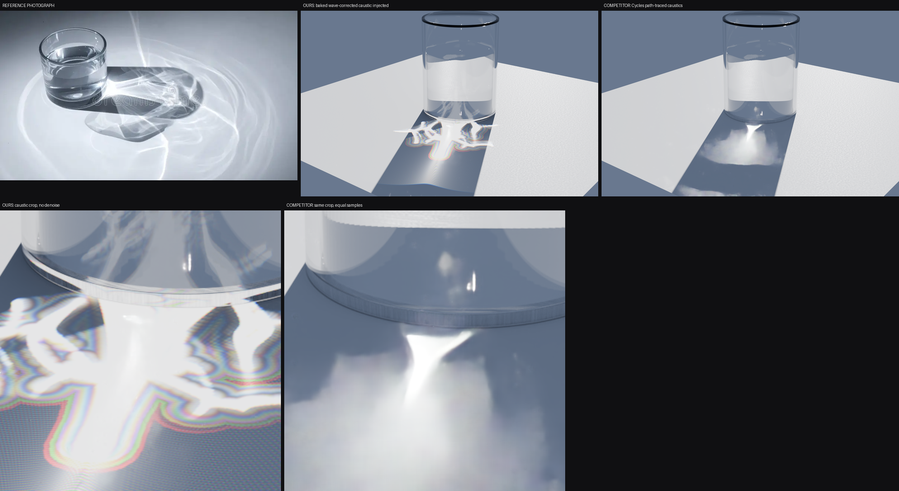
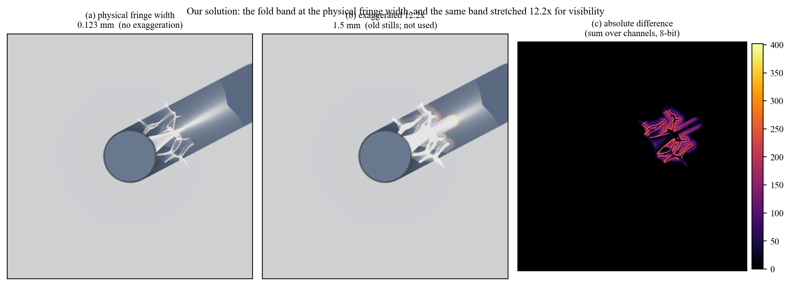
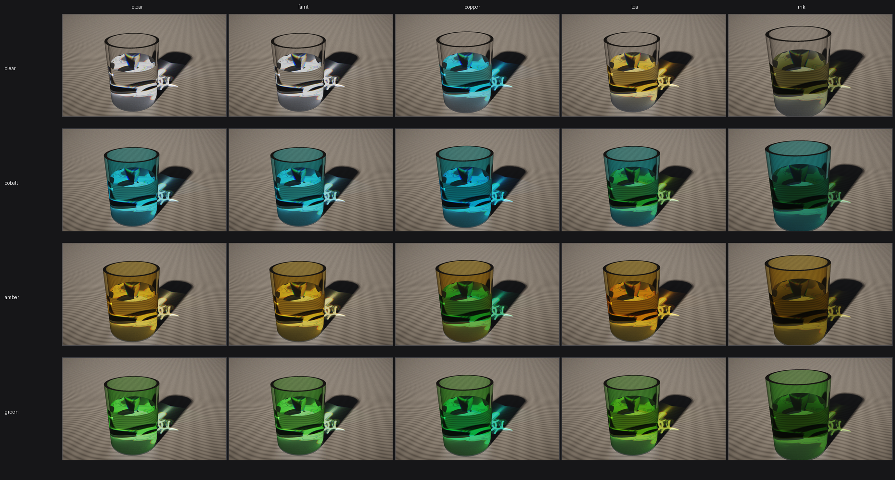
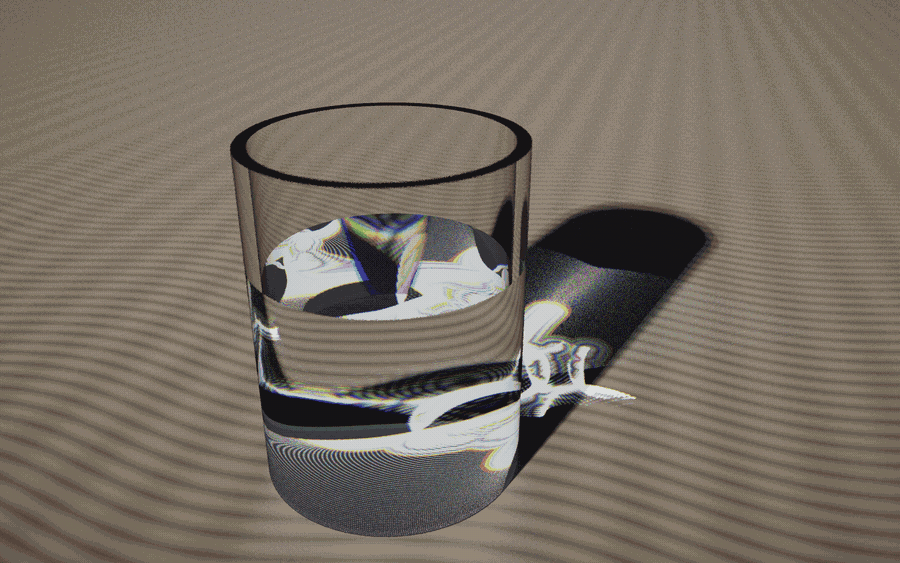
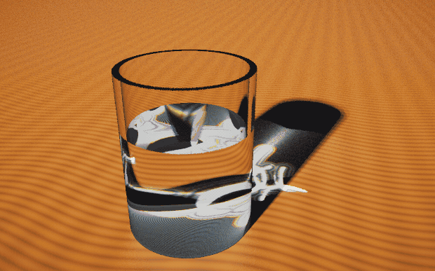
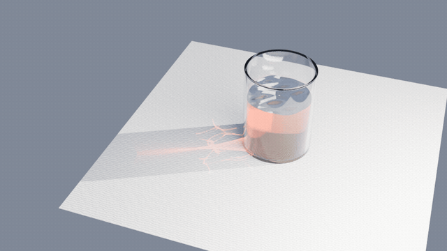
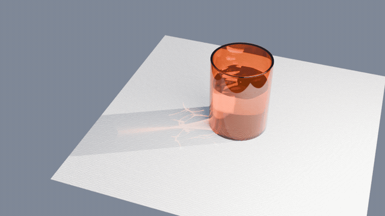

# LUMENFOLD

### Wave-corrected caustics over photon splatting

[](LICENSE)
[](docs/paper/main.pdf)
[](https://orcid.org/0009-0004-2672-3503)
[](#quickstart)
[](#quickstart)

A caustic estimator that replaces the geometric fold singularity with the
wave-optical **Airy** profile inside a detected fold band, plus a measured
comparison against the caustic solvers in current practice — **PBRT-v4 SPPM**,
**Blender Cycles** and **Mitsuba 3**.

<p align="center">
  
  <br>
  <em>One animation, one camera, three renderers. Left to right: our wave-corrected
  field, Blender Cycles tracing the caustics itself, and PBRT-v4 SPPM. Reproduce with
  <code>python tools/make_hero.py</code>.</em>
</p>

The geometric push-forward that both photon splatting and path tracing evaluate has a
vanishing Jacobian determinant at a fold, so the estimator diverges there and no
amount of sampling repairs it. This project states that failure as a property of the
geometry rather than of the discretisation, and applies the wave-optical correction
only inside a narrowly detected band — where it is cheap, physically motivated, and
keeps the band's own energy.

- 📄 **[Read the paper](docs/paper/main.pdf)** — 23 pages, official Eurographics /
  *Computer Graphics Forum* class (`egpubl.cls`). Section 11 is the full reproduction list.
- 🔬 **[Every number, traced](docs/EVIDENCE.md)** — the measurement log, including the
  results that went against us.
- ⚔️ **[Our own attack on our claims](docs/CRITIQUE.md)** — the adversarial audit, and
  three claims from our earlier record that are explicitly withdrawn.

---

## Contents

- [Results](#results)
- [Quickstart](#quickstart)
- [How it works](#how-it-works)
- [No exaggerated fringes](#no-exaggerated-fringes)
- [Repository map](#repository-map)
- [Reproducing the results](#reproducing-the-results)
- [Honest scope](#honest-scope)
- [History](#history)
- [License](#license) · [Citation](#citation)

---

## Results

Quality, scored on **one independent axis** — a brute-force geometric trace of 810 k
explicit rays that neither method produced — with an identical metric:

| correlation vs. independent trace | ours | PBRT-v4 SPPM | Cycles |
|---|---|---|---|
| 40 mm tiles | **0.917** | 0.853 | 0.828 |
| 5 mm tiles | 0.721 | **0.722** | 0.405 |
| coverage of the ground-truth caustic core | **99.9 %** | — | 54.7 % |

Speed — and this is **not** a uniform win:

| workload | ours | Cycles | PBRT-v4 SPPM |
|---|---|---|---|
| produce a caustic, 512² | **36.22 ms** (8 threads) | — | 34 s |
| production still, 1600×1000 @ 2048 spp | 34.1 s | 36.1 s | — |
| orbit clip, 1280×720, 120 frames | **773.3 s** | 1043.2 s | — |
| ripple clip, 960×540, 72 frames | 481.9 s | **453.0 s** | — |

**Read the caveats, they matter.** The method is 2–3 orders of magnitude cheaper at
*producing* a caustic for this geometry family, and wins on animations that re-bake per
frame (1.35×, with 7.9× less caustic flicker). But it **ties on a single still**, **loses
to Cycles** on the static-camera clip, and plain Monte-Carlo is **more accurate below
~262 k splats**. Our caustic is also **too smooth** — 2.30× broader than the brute-force
trace at 1024² (1.87× at 4096²).

## Quickstart

The solver and every number in the paper need **only a C++ compiler, CMake and Python**.
There are no mandatory third-party dependencies.

```bash
# Build the solver (8 targets, no external SDKs)
cmake -S . -B build
cmake --build build --config Release

# The independent ground truth, then the three-way accuracy against it
python tools/verify_ray_map.py
python tools/accuracy_vs_ground_truth.py
```

**Not needed to reproduce the paper:** only the two interactive 3D viewers want MuJoCo
and Filament (~5 GB). They are skipped automatically when absent — `src/physics` guards
its MuJoCo include behind an `if(EXISTS)` test — and `tools/fetch_third_party.sh`
fetches them if you want the viewer. The reference renderers used for comparison
(PBRT-v4, Mitsuba 3, Blender) are external projects expected on `PATH`.

Python side: `numpy` for the analysis tools, plus `scipy` for
`verify_wave_correction.py` and `matplotlib` for the figure scripts.

## How it works

1. **Geometric backbone.** Refract the surface by Snell's law and splat to the receiver,
   with the ray map `H(x)` and its Jacobian `det J`. Efficient wherever the map is
   smooth, divergent where it folds.
2. **Fold locus.** Detect `det J = 0` analytically (2nd percentile) instead of by
   intensity percentile — the percentile detector always flags 2 % of pixels and
   therefore never converges.
3. **Band-local Airy replacement.** Inside the band, redistribute the band's *own*
   energy by `|Ai(-s/w)|²` with per-channel width `w ∝ λ^(2/3)`, so fringes stay finite
   and chromatic ordering follows from the profile and the measured index laws rather
   than being added as an effect.

Verified independently of the solver: the profile equals true Airy to **8.118e-03** of
peak, the canonical cubic-phase fold integral peaks at `X = −1.00` against the analytic
`−1.0188`, the fringe exponent measures **0.6977** against an analytic `2/3`, and a
closed-form cylinder caustic is reproduced to **0.1 mm**.

<p align="center">
  
</p>

## No exaggerated fringes

Earlier versions of this repo baked the fold band at `airy_scale = 1.5 mm` so the fringes
would be visible on screen. That value is **12.2× the physical fringe width** for this
geometry (0.123 mm), and the real-time baker's own default of 20 mm is 163×. Those
renders are honest pictures of a model that is not this one, and every result in the
paper now uses the physical width.

<p align="center">
  
</p>

Left: our solution at the **physical** fringe width — what the paper and the GIFs use.
Middle: the same band stretched 12.2× for visibility, which is what the older stills in
`out/` show and what no result is quoted from. Right: the difference.

Worth noticing from the difference panel: exaggeration changes the *fringe structure*
inside the band, not the position or the extent of the caustic — the bright region keeps
the same footprint in both. So an exaggerated render is not "wrong about where the light
goes", it is wrong about the texture inside the fold; at the physical width that texture
is below the resolution of the bake anyway (the band is about 2 px at 1024²). That is the
same conclusion the paper reaches from the coherence argument: the fringes are the visible
signature of the correction, not its justification.

## Colour: the caustic, the fringes, and a sun that moves

The fringes are coloured, and the reason is dimensional: the fold band's width goes as
λ^(2/3), so the three channels put their bright edge in three different places. Measured
Airy scales are 1.749 / 1.565 / 1.369 µm, whose ratios are 1.1178 / 1.000 / 0.8748 — the
analytic (λ/550)^(2/3) values to four decimals. The caustic therefore has a coloured edge
even under a colourless source.

<p align="center">
  
</p>

Twenty rendered caustics — every tinted glass against every tinted water — from the same
real-time baker. The numeric side of this is the **complete 4×5×4 factorial** (glass ×
water × source, 80 combinations) in `docs/data/colour_results.json`, computed from three
traced ray maps: the geometry does not depend on the medium, so each combination is only a
reweighting of rays already traced and the whole sweep is nearly free. Across the 80 the
hue spread is red 20, green 18, yellow 15, blue 14, cyan 11, neutral 2.

Two findings worth stating plainly, because they are easy to get backwards:

* **The medium and the source are interchangeable for tint.** Both act by multiplying the
  three channels independently, so a blue-tinted water and a cool sun produce a similar
  core colour by different means. Moving the source from solar to 3400 K shifts the core's
  normalised RGB by 0.620, comparable to tinting the glass at all.
* **Neither can move a fringe.** The colour *sequence* across the band only responds to
  λ^(2/3). So a coloured fringe pattern is evidence of the wave correction specifically,
  not of coloured media.

One correction worth recording, because the rendered grid originally contradicted the
table above it. The caustic field was baked as a **purely geometric** quantity —
compression × Airy profile — and the shader then multiplied it by `tp`, the throughput
along the **camera** ray. But the caustic is a *light-side* quantity: its colour is set by
what the sunlight crossed before landing. For the fan thrown clear of the glass the camera
path is pure air, so `tp ≈ 1` and the water could not tint the caustic at all — measured, a
copper water that should remove 90% of the red moved the caustic by 0.2%, and water set to
an opaque 500/m left it unchanged. Glass appeared to work only because some caustic pixels
are seen *through* the glass.

The fix carries the light path into the field: `Hit` now records the metres travelled in
glass and water, each ray is weighted by `exp(−µL)` per channel, and the channel's mean
transmission is restored after the shape normalisation so the three channels stop being
equal. Copper water now takes the caustic from R/G 1.03 to 0.53 — a 194-level change.
`A_c` is a uniform per-channel scalar, so field peak positions, extents and the chromatic
separation are invariant; only intensities move. Confirm with
`tools/caustic_colour_probe.py` and `tools/render_vs_computed_colour.py` (rendered against
computed, tile by tile — the check that would have caught this immediately).

<p align="center">
  
</p>

With the **camera held fixed** and the sun rotated a full turn about the glass, the caustic
orbits: its centroid traces a circle of 54.2 mm (σ = 0.7 mm) and is thrown on the far side
of the glass from the source. This needed a code change, and the reason is a trap worth
recording — by default the camera follows the caustic's centroid, so rotating the source
makes the frame pan to follow it and **the two motions cancel**; the caustic looks static,
which is the opposite of what is happening. `--cam-fixed` locks the frame.

<p align="center">
  
</p>

The source spectrum swept from 2000 K to 12000 K. This one is a **palindrome** rather than a
one-way ramp: a ramp loops with the cool end snapping back to the warm end, which measured
as a 20× jump at the wrap — a flash, not a sweep. Going up and back makes the wrap an
ordinary frame step (loop-to-median ratio 0.00).

### Red medium, one variable at a time

The same ripple animation as `ripple_ours.gif` — same camera, same physical Airy width,
same studio rig, same 72 frames — with only the medium changed:

<p align="center">
  
</p>
<p align="center">
  <em>red water</em>
</p>
<p align="center">
  
</p>
<p align="center">
  <em>red glass</em>
</p>
<p align="center">
  
</p>
<p align="center">
  <em>both</em>
</p>

Coefficients are per-metre Beer–Lambert chosen so each medium transmits roughly
(0.90, 0.15, 0.03) over its real path — about 90 mm of water and 3.5 mm of glass. They are
experiment parameters, not measured materials. Exposure is deliberately **not** re-solved
per clip: the Blender render is the final image, so the red medium genuinely loses light,
and re-normalising each clip would hide exactly that.

Two things that make these work, both of which are easy to miss:

* The colour has to be set **twice**. `--water-abs/--glass-abs` on the bake tints the
  caustic field, which is a light-side quantity; `--water-absorb/--glass-absorb` on the
  Blender side tints the glass and water bodies through a volume shader. Doing only one
  gives you a red object with a neutral caustic, or a red caustic in a clear glass.
* `scene.cycles.volume_bounces` defaults to **0**, and at 0 Cycles *silently ignores* a
  connected volume shader. The absorption is built into the material, never integrated,
  and the medium renders colourless with no warning anywhere in the log. `blender_scene.py`
  now sets it to 8.

Measured in the glass region: R goes 0.978 → 1.000 and B drops 1.000 → 0.955 against the
clear clip. The whole frame stays comparatively cool, which is correct — the studio rig
illuminates the table directly and is not filtered by the medium.

Reproduce with `tools/ripple_colour_gifs.py --case all`.

Reproduce all of it with `tools/colour_study.py` (numbers) and
`tools/colour_experiments.py` (renders); `tools/make_colour_figure.py` builds the figure the
paper uses.

## Blender add-on

The caustic baker ships as a Blender add-on. Instead of letting Cycles path-trace the
caustics — the noisiest thing in a glass render, and worse as the source shrinks — it bakes
the wave-corrected caustic deterministically and injects it into a Cycles material as light.
It can also give the glass and water a **coloured medium**.

**Full instructions: [docs/BLENDER_PLUGIN.md](docs/BLENDER_PLUGIN.md)** — install, every
control, the scene contract, and troubleshooting.

    Edit > Preferences > Add-ons > Install from Disk…  →  blender_addon/caustic_injector.py
    N-panel (3D View sidebar) > Caustic tab

Quick start: set **Target**, then **Bake caustic → Inject into material → render**.

Two things the docs exist mainly to prevent, because both fail *silently*:

* A caustic's colour is set by the path the **light** travelled. The bake is what tints
  it (`Glass absorb` / `Water absorb`); the medium's own body needs a separate volume
  shader (**Tint this object's medium**). Set one and not the other and you get a red
  caustic in a clear glass, or a red glass with a neutral caustic.
* `scene.cycles.volume_bounces` defaults to **0**, and at 0 Cycles ignores a connected
  volume shader entirely — colourless medium, no warning, nothing in the log. The tint
  operator raises it for you; if you wire volumes by hand, set it yourself.

## Repository map

```
src/render/caustic.*          pool-scene caustic field baker (1-D, real-time path)
src/render/airy_lut.*         the 2048-entry Airy profile table (+ generator)
src/app/showcase_main.cpp     the paper's offline estimator + showcase renderer
src/app/bench_main.cpp        bake timing harness
src/app/dump_main|parity_main parity / dump helpers
src/physics/two_medium.*      ORIGIN of the scene: air/water buoyancy (see History)
src/app/viewer_*.cpp          MuJoCo + Filament viewer from that earlier stage
models/, blender_addon/       MJCF scene, Blender caustic injector
tools/                        measurement + verification harnesses  -> tools/README.md
docs/                         paper, evidence, audit, figures, media -> docs/README.md
third_party/                  prebuilt drops, NOT committed (tools/fetch_third_party.sh)
out/                          working artefacts (gitignored); out/probes = superseded
```

Two index files carry the detail: **[`tools/README.md`](tools/README.md)** groups all 60+
harnesses by what they measure, and **[`docs/README.md`](docs/README.md)** indexes the
paper, the evidence log and the media.

## Reproducing the results

The paper's own reproduction list is **Section 11**. The core harnesses:

```bash
python tools/verify_ray_map.py            # the independent brute-force ground truth
python tools/verify_wave_correction.py    # Airy profile, fold integral, λ^(2/3)  (needs scipy)
python tools/accuracy_vs_ground_truth.py  # three-way accuracy against that truth
python tools/spmm_vs_groundtruth.py       # SPPM scored on the same axis
python tools/analytic_caustic.py          # closed-form cylinder reference
python tools/energy_audit.py              # Fresnel-weighted energy bookkeeping
python tools/ensemble_study.py            # robustness across 8 wave phases
python tools/colour_study.py              # caustic + fringe colour, full 80-combination factorial
python tools/colour_experiments.py        # rendered media grid, sun orbit, source sweep
python tools/make_all_figures.py          # all ten paper figures, in order
python tools/make_hero.py                 # the comparison animation at the top
python tools/build_paper_pdf.py           # compile the CGF paper
python tools/check_paper.py               # dangling refs, title page, flattened files
python tools/scan_ai_tells.py             # AI-writing tells in the manuscript
python tools/verify_refs.py               # every citation, against Crossref
```

Every tool derives the repository root from its own `__file__`, so they run from any
working directory.

## Honest scope

One scene, one machine, no laboratory ground truth — this is a **computational
evaluation** and physical-apparatus validation is deliberately out of scope. The physical
claim is one of *form* (finite fringes, chromatic ordering, no `1/√·` divergence), not
absolute fringe width: for a glass this size the real fringes are 0.123 mm wide and a
0.53° sun blurs them away entirely, so a photograph would not show them however they are
rendered. The efficiency claim is amortised against **one fixed geometry family**; change
the optic and the solver needs new work.

Further limits are itemised in **Section 8** of the paper. Two are worth stating here:

- **The correction is defined only for a fold — and the cusp case has now been
  tested.** At a cusp the local phase is quartic and the diffraction pattern is a
  **Pearcey** function rather than an Airy one, and the divergence exponent changes
  with it: a fold's amplitude goes as `|δ|^-1/4`, a cusp's as `|y|^-1/3` (measured
  −0.2434 and −0.3333 against the analytic −1/4 and −1/3). The substitution itself
  transfers cleanly — the corrected field is bounded exactly where the geometric one
  diverges. **The cost does not**: a direct Pearcey evaluation measures ~2.1×10⁴
  slower than an Airy table lookup, and the table route that would make it affordable
  needs roughly 35 minutes to build at 256². The generalisation is mathematically
  available and computationally is not, at least not this way — see
  `tools/pearcey_cusp.py`.
- **The coherent limit is not the sun.** The source subtends 0.53°, a geometric blur of
  ~925 µm at the receiver, against a physical fringe spacing of 123 µm — about 7.5×
  smaller. A photograph of this scene under the sun would not show the fringe structure
  this paper computes, and the figures should not be read as a prediction of one.

## History

This repo began as an air/water interaction demo: `src/physics/two_medium.*` implements
the Archimedes force with a centre of buoyancy for MuJoCo (the gap filed as
[google-deepmind/mujoco#3452](https://github.com/google-deepmind/mujoco/issues/3452),
closed unmerged), rendered through Filament. `models/pool.xml` and the `viewer_*` binaries
are that stage, kept because the caustic work grew out of the same scene. The caustics
estimator and the comparison against SPPM/Cycles/Mitsuba — the current work — live in
`src/render/caustic.*` and `src/app/showcase_main.cpp`.

## License

[MIT](LICENSE) for the code, tools and figure scripts. The paper text
(`docs/paper/**`, `docs/PAPER.md`) is a manuscript intended for journal submission and is
governed by the venue's terms, not by the MIT grant.

## Citation

If you use this work, please cite the paper once it appears; the ORCID is stable in the
meantime.

```bibtex
@misc{chetri2026lumenfold,
  title  = {Wave-Corrected Caustics over Photon Splatting},
  author = {Chetri, Ankit},
  year   = {2026},
  note   = {ORCID 0009-0004-2672-3503},
  url    = {https://github.com/Debyte404/LUMENFOLD}
}
```
