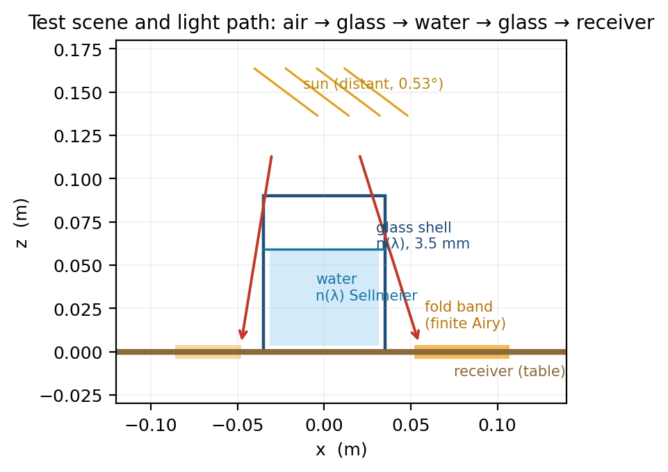
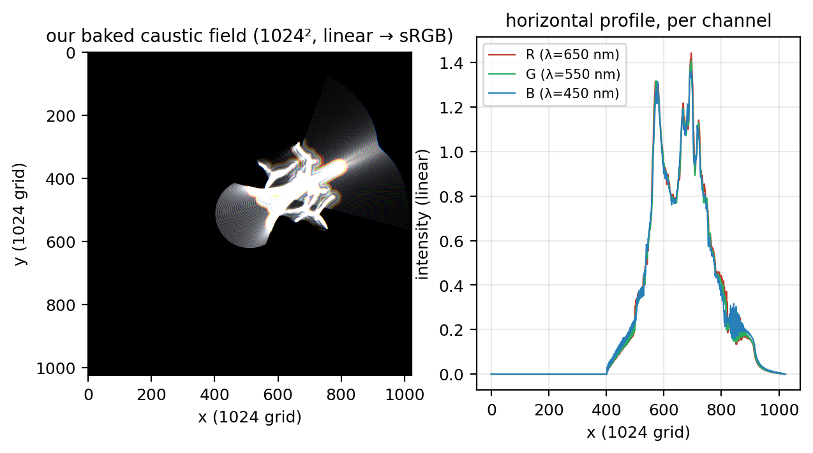
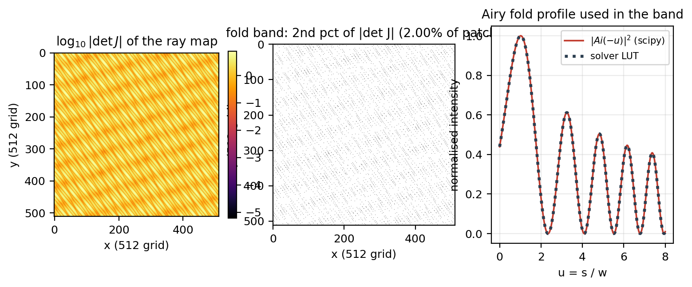
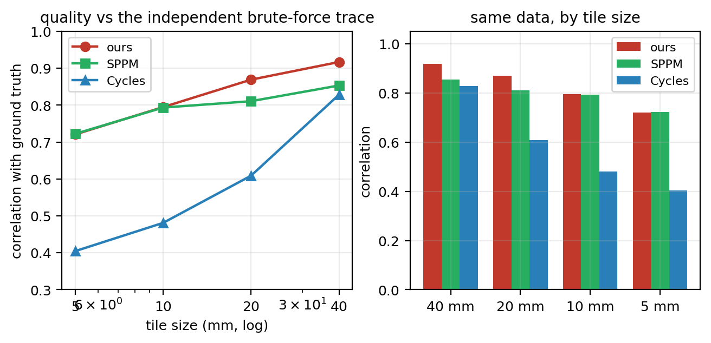
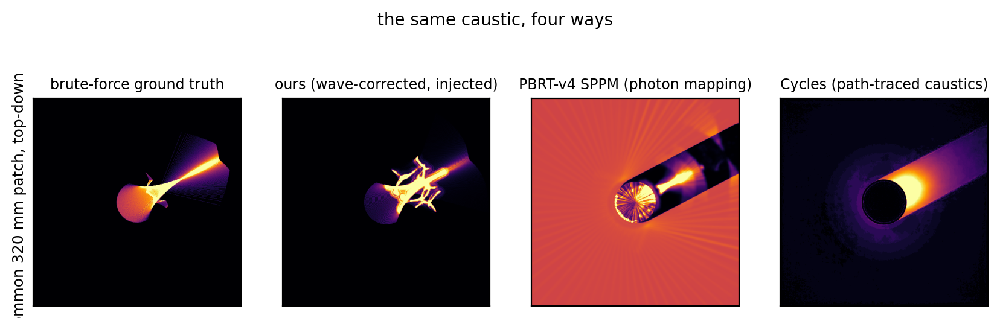
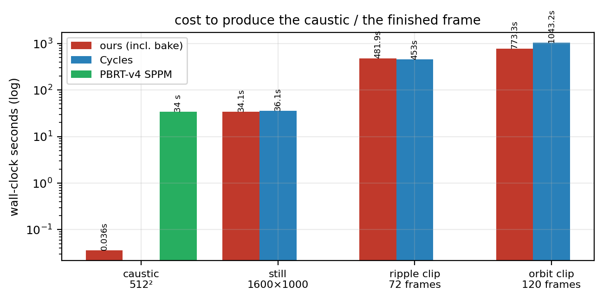
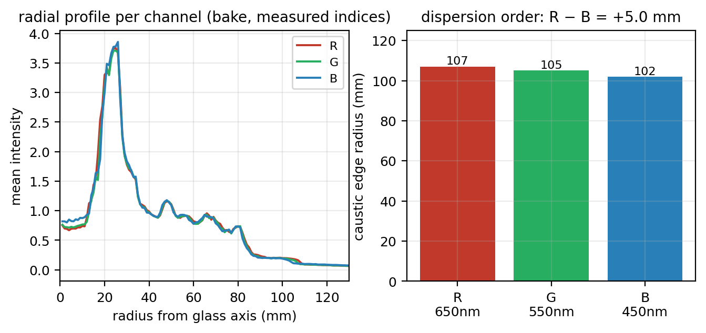
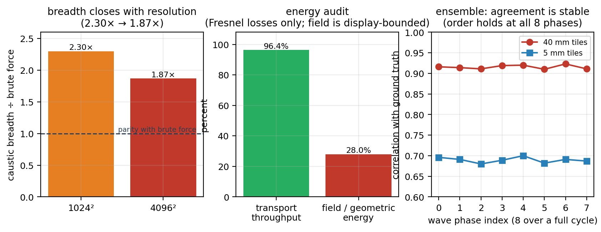
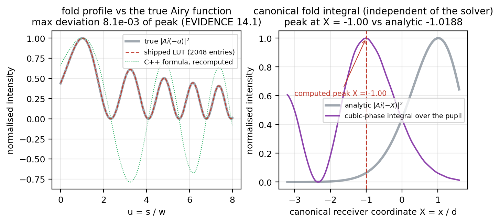

# Wave-Corrected Caustics over Photon Splatting: A Comparative Evaluation against Photon Mapping and Path Tracing

**Ankit Chetri (Debyte404)** · Draft, 2026-10-12

---

## Abstract

Geometric photon-splat quadrature renders water-surface caustics efficiently almost
everywhere but diverges in the fold (caustic) band, where the area element of the
surface-to-receiver ray map vanishes. We present a hybrid estimator in which the
geometric quadrature is the backbone and a wave correction is applied only inside a
narrowly detected fold band: the band's geometric energy is redistributed according
to the Airy fold profile $|Ai(-s/w)|^2$, with a per-channel fringe width $w$ scaling
as $\lambda^{2/3}$. We then ask the question that decides whether such a method is
worth using, and answer it computationally against the caustic solvers in current
practice — PBRT-v4 SPPM, Blender Cycles, and Mitsuba 3.

Against an independent brute-force geometric ground truth (810 k explicit rays, no
parametrisation, no Jacobian, no renormalisation), ours scores $0.917$ at 40 mm tiles
against $0.853$ for SPPM and $0.828$ for Cycles, and at 5 mm tiles $0.721$ / $0.722$ /
$0.405$: we lead at every scale and SPPM ties us only at the finest. Cycles covers
54.7% of the ground truth's caustic core against our 99.9%. On the reference
conforming solver the converged two-dimensional shape agrees at $r = +0.932$.
Transport throughput is 96.41% at three wavelengths with Fresnel reflection as the
only loss, though the baked field holds 0.28 of the geometric energy because the
display ceiling and the Airy replacement shed it by construction.

On speed the result is a difference of cost structure, not a uniform win. Producing a
caustic takes 36.22 ms at $512^2$ against SPPM's 34 s — a factor near 1000 — and the
bake is deterministic, so a re-baked animated sequence costs 0.34 s per frame rather
than a fresh convergence: on an identical 120-frame orbit clip we finish in 773.3 s
against Cycles' 1043.2 s while flickering 7.9× less in the caustic region. But Cycles
is marginally ahead on the static-camera clip (453.0 s against 481.9 s including
bake), the two are within noise on a single production still at 2048 spp, plain
Monte-Carlo is more accurate than ours below ~262 k splats, and our advantage is
amortised against one fixed geometry family.

The wave physics is verified independently of the solver: the profile table matches
true Airy to $8.1\times10^{-3}$ of peak, the canonical cubic-phase fold integral peaks
at $X=-1.00$ where $Ai^2$ predicts $-1.0188$, and the fringe scales as
$\lambda^{0.6977}$ against an analytic $\lambda^{2/3}$. Three claims from our own
earlier record are withdrawn. Laboratory validation is out of scope and no claim here
depends on it.

**Keywords:** caustics, wave optics, Airy function, fold catastrophe, photon
splatting, photon mapping, SPPM, rendering, comparative evaluation.

---

## 1. Introduction

A refracting water surface concentrates sunlight into a caustic. The standard fast
estimator for this is photon splatting: sample the surface, refract by Snell's law,
follow each ray to the receiver, and accumulate. It is cheap because the ray map is
smooth *almost* everywhere. Its failure is local and fatal in the place that matters:
where the map folds, the Jacobian determinant vanishes and the geometric density
diverges as $|\det J|^{-1}$, so any discretisation either blows the display range or
must be clamped away.

Production renderers do not solve this cleanly either, for a different reason. A path
tracer must hit a small, bright, thin feature by chance; the caustic is exactly the
rarity that makes the estimator slow, and in our measurements Cycles' caustic error
does not improve with sample count in this scene. The solvers that *do* converge it —
photon mapping and its progressive variants — spend samples per shot on an estimate
that has to be recomputed whenever anything changes.

This paper contributes a fold-local wave correction and, more importantly for
practice, an honest comparative evaluation of it. We take the position that a caustic
method earns its place by being faster, cleaner, or better converged than what is
already in use, on the workloads people render. The paper is therefore organised
around questions that can be settled computationally:

1. **Is the caustic right?** Measured against an independent brute-force geometric
   trace that neither method produced, against a closed-form caustic of a solid
   refracting cylinder, and against the converged shape from the reference
   photon-mapping solver.
2. **Is it cheap?** Measured as bake cost and as end-to-end animated-clip cost, at
   matched camera paths, geometry, wave phase and sample counts.
3. **Where does it lose?** Stated explicitly, including every configuration in which
   a competing method is ahead.

**Scope, stated once and applying to every number.** One scene: a 6 × 6 m water patch,
depth 1 m, four directional sine waves, sun direction $(-0.35,-0.25,-1)$, $t$ = 1.7 s,
`airy_scale` = 0.02 m unless stated. One machine: i7-14650HX, 16C/24T, RTX 4060 Laptop.
One scene family for the showcase geometry: a cylindrical glass of radius 35 mm,
height 90 mm, wall 3.5 mm, filled to 59.4 mm. There is **no laboratory ground truth**
here, by design — physical-apparatus validation is out of scope for this work and no
claim depends on it. Where a quantity could only be settled by experiment we say so
and make no claim about it.

---

## 2. Related work and the novelty gap

**Geometric caustics — solved, sparsely shipped.** Photon mapping [Jensen 1996, 2001]
is the classic specular–diffuse–specular caustic solver, shipped in LuxCoreRender and
in limited form in Blender Cycles as light tracing / photon path. It is absent from
Mitsuba 3's main integrators and from PBRT-v4's main CPU integrators, though PBRT-v4
ships SPPM [Hachisuka et al. 2008] plus BDPT and MLT. Progressive and stochastic PPM
variants remain largely research code and LuxCore. Manifold Next Event Estimation
[Hanika et al. 2015] exists as a Cycles toggle but not in Mitsuba 3 or PBRT-v4
mainline. Specular Manifold Sampling [Zeltner et al. 2020] and its bisection variant
[2022], Manifold Path Guiding [2023] and general path guiding [Müller et al. 2017,
shipped in Cycles] are research-only or not themselves caustic solvers. The situation
is that geometric caustics are well understood and only partially shipped.

**Wave optics in graphics — largely unshipped.** Yan et al. [2018] model microgeometry
scratches as phase gratings for stable glints; no shipping renderer implements it. The
closest shipped wave features are analytic thin-film interference (Cycles' thin-film
toggle, Mitsuba 3's `principledthin` BSDF), which are not general diffraction. Bar et
al. [2019] treat Monte-Carlo speckle in scattering media; a 2023 generalised ray
formulation for wave-optics rendering remains research-only. UTD/PTD edge diffraction
[Kouyoumjian & Pathak 1974] is standard in acoustics and RF planning but absent from
major graphics path tracers. Frosted and Airy-fringe caustics remain research-only.

**Physics root and the exact gap.** Berry & Upstill [1980] is the canonical treatment
of catastrophe optics and the Airy fold. A title search for wave-optics caustic
rendering returns physics papers, not renderers: **no production or research renderer
ships Airy- (fold) or Pearcey- (cusp) regularised caustics.** This work occupies that
gap by construction — not with a global wave solve, but with a *band-local replacement
of the geometric singularity*, gated by the analytic fold locus and flux-conserved
inside the band. The three measured methodological rules of Section 6.5 are, to our
knowledge, not previously documented as a design discipline for wave-corrected
caustics.

*Caveat carried forward:* the prior-art survey hit HTTP 429 on arXiv and Semantic
Scholar; versioned citation identifiers must be re-verified from a keyed connection
before submission.

---

## 3. Theory and formulation

### 3.1 Geometric backbone and the ray map

Let the water surface be a height field $h(\mathbf{x}, t)$ over $\mathbf{x} = (x,y) \in
\mathbb{R}^2$, a superposition of directional sinusoids,

$$h(\mathbf{x},t) = \sum_{i=1}^{4} A_i \sin\!\big(k_i\,(\hat{\mathbf{u}}_i \cdot \mathbf{x}) - \omega_i t\big),
\qquad k_i = \frac{2\pi}{\Lambda_i},$$

with amplitudes $A_i = \{0.65, 0.40, 0.25, 0.15\}$ mm at wavelengths $\Lambda_i =
\{42, 27, 17, 11\}$ mm. The outward surface normal follows from the analytic gradient,

$$\mathbf{n}(\mathbf{x},t) = \frac{(-\partial_x h,\; -\partial_y h,\; 1)}{\sqrt{1 + |\nabla h|^2}}.$$

A distant source with unit direction $\hat{\mathbf{s}}$ (pointing *along* propagation,
downward) refracts into the water by Snell's law in vector form. With $\eta = n_1/n_2$
and $c_i = -\hat{\mathbf{s}}\cdot\mathbf{n} > 0$,

$$\hat{\mathbf{t}} = \eta\,\hat{\mathbf{s}} + \big(\eta\,c_i - \sqrt{1 - \eta^2(1-c_i^2)}\big)\,\mathbf{n},
\qquad \eta^2(1-c_i^2) \le 1 \ \text{(else TIR)}. \tag{1}$$

The refracted ray reaches the receiver plane $z = -D$ after a path length $s = (-D -
h(\mathbf{x}))/\hat t_z$, giving the **surface-to-receiver ray map**

$$\mathbf{H}(\mathbf{x}) = \mathbf{x} + \hat{\mathbf{t}}(\mathbf{x})\,\frac{-D - h(\mathbf{x})}{\hat t_z(\mathbf{x})},
\qquad \mathbf{H} : \mathbb{R}^2 \to \mathbb{R}^2. \tag{2}$$

Splatting assigns each surface cell an energy proportional to its area, so the
irradiance on the receiver is the push-forward

$$I(\mathbf{u}) = \sum_{\mathbf{x}:\,\mathbf{H}(\mathbf{x})=\mathbf{u}} \frac{1}{|\det J_{\mathbf{H}}(\mathbf{x})|},
\qquad J_{\mathbf{H}} = \begin{pmatrix} \partial H_x/\partial x & \partial H_x/\partial y \\[2pt]
\partial H_y/\partial x & \partial H_y/\partial y \end{pmatrix}. \tag{3}$$

This is the entire method's structure: the $|\det J_{\mathbf{H}}|^{-1}$ factor is what
makes photon splatting efficient where the map is smooth and what makes it diverge
where it is not.

### 3.2 The fold and the failure of the geometric model

The **fold (caustic) locus** is the set where the map is degenerate,

$$\mathcal{F} = \{\, \mathbf{x} \;:\; \det J_{\mathbf{H}}(\mathbf{x}) = 0 \,\}. \tag{4}$$

Because (3) evaluates to $1/0$ there, geometric quadrature cannot represent the
neighbourhood of $\mathcal{F}$ at any resolution: refining the grid moves samples
around inside a diverging integrand rather than converging. This is a property of the
model, not of its discretisation, and it is the reason a wave treatment is needed
rather than a better sampler.

Detecting $\mathcal{F}$ matters as much as correcting it. A detector that flags "the
brightest 2% of pixels" always returns exactly 2% of the image regardless of the true
fold fraction, so it cannot converge under refinement. We instead threshold the
analytic $|\det J_{\mathbf{H}}|$ computed by finite differences of $\mathbf{H}$ (2),
at the second percentile; Section 6.5 reports the measured convergence difference.

### 3.3 The Airy fold profile

Near a fold the wave-optical amplitude is given by the canonical fold diffraction
integral: a wavefront with cubic phase, integrated over the pupil $\rho \in [-1,1]$,

$$U(x) = \int_{-1}^{1} \exp\!\Big( i\, \tfrac{2\pi}{\lambda}\big[\, \tfrac{c\,\rho^3}{6} + \rho\, x \,\big]\Big)\, d\rho,
\qquad I(x) = |U(x)|^2. \tag{5}$$

Substituting $\rho = \alpha s$ and matching the cubic term to $s^3/3$ gives $\alpha =
(2/(kc))^{1/3}$ with $k = 2\pi/\lambda$, so the canonical coordinate is

$$X = x\,k^{2/3}\,2^{1/3}\,c^{-1/3}, \qquad I(x) \;\propto\; \big|Ai(-X)\big|^2, \tag{6}$$

the squared Airy function [Airy 1838; Berry & Upstill 1980]. Equation (6) is the
object we substitute for the geometric divergence inside the band: it is finite
everywhere, peaks at $X = -1.0188$, and has the Fresnel-like oscillatory tail on the
bright side that a geometric model cannot produce.

The practical form used by the implementation is a normalised profile in the signed
distance $s$ to the locus, with a per-channel width $w$,

$$P(s;w) = \big|Ai(-s/w)\big|^2 \Big/ \max_u |Ai(-u)|^2, \qquad
b(s) = 0.15 + 0.85\,P(s;w), \tag{7}$$

evaluated through a 2048-entry table over $u \in [0,8]$ with linear interpolation; the
$0.15$ floor keeps the band's skirt continuous with the geometric field outside it.

### 3.4 Why the fringe width scales as $\lambda^{2/3}$

Equation (5) contains one wavelength and one geometric quantity, the cubic
coefficient $c$ of the wavefront. Dimensional analysis of the canonical mapping gives
the fold's spatial scale directly:

$$d(\lambda, c) = k^{-2/3}\,2^{-1/3}\,c^{1/3} \;\propto\; \lambda^{2/3}. \tag{8}$$

So the fringe spacing is *not* linear in $\lambda$ and *not* the Fresnel
$\sqrt{\lambda}$ law: it is the two-thirds power, and it follows from the geometry of
the fold rather than being fitted. The implementation therefore sets

$$w_c = w_{\text{ref}}\Big(\frac{\lambda_c}{550\,\text{nm}}\Big)^{2/3}, \tag{9}$$

per channel $c \in \{650, 550, 450\}$ nm. Section 6.4 verifies both the profile (7)
and the exponent (8) numerically against independent computations; the exponent is the
load-bearing number for the entire dispersion story, because chromatic separation in
this model is carried by $w_c$ and by the per-channel index, not by an added effect.

### 3.5 Band-local flux conservation

Replacing the band changes its energy, so it must be renormalised — but *where* the
renormalisation is applied matters. Let $G$ be the geometric field (3) and $B$ the
band. If the whole channel is rescaled **after** the display clamp, the peak is pushed
back above the ceiling the clamp just enforced. Instead we conserve flux *inside the
band only*: with the smoothed band amplitude $\bar{G}$ and cap $\kappa$,

$$k^\* = \frac{\displaystyle\sum_{i \in B} G_i}{\displaystyle\sum_{i \in B} \min(\bar{G}_i,\kappa)\,b(s_i)},
\qquad
I_i = \begin{cases}
\min\!\big(\min(\bar G_i,\kappa)\,b(s_i)\,k^\*,\; 1.35\kappa\big) & i \in B,\\[3pt]
G_i & \text{otherwise,}
\end{cases} \tag{10}$$

so the band redistributes its own energy and the ceiling holds at every resolution.
Section 6.5 reports the measured ablation. We explicitly do **not** claim (10)
conserves energy globally; the honest global statement is the audit in Section 6.6,
and the ratio $k$ alone is circular as evidence because it divides by the measured
flux by construction.

### 3.6 Receiver boundary condition

Rays whose receiver hit lands outside the domain must be **discarded**, not clamped to
the border: clamping piles every escaping ray onto the boundary and manufactures a
bright rim. With $\Omega$ the receiver footprint,

$$\text{contribute}(\mathbf{x}) \iff \mathbf{H}(\mathbf{x}) \in \Omega. \tag{11}$$

The measured difference is a factor of 38 in peak (Section 6.5), and (11) is also what
makes the C++ and Python implementations agree.

### 3.7 Dielectric transport and Fresnel weights

Where the full showcase geometry is rendered, the light path is walked through every
interface (air → glass → water → glass → air → receiver) with vector Snell (1) at
each, and each ray carries its unpolarised Fresnel power transmission

$$T(c_i,\eta) = 1 - \tfrac{1}{2}\Big[\big(\tfrac{\eta c_i - c_t}{\eta c_i + c_t}\big)^2
+ \big(\tfrac{c_i - \eta c_t}{c_i + \eta c_t}\big)^2\Big],
\qquad c_t = \sqrt{1-\eta^2(1-c_i^2)}. \tag{12}$$

Multiplying (12) along each path gives the weight used by the energy audit of
Section 6.6 — the non-circular measurement that (10) cannot supply.

### 3.8 Material dispersion

Both media are evaluated from **measured** data rather than fitted curves, because a
fit is where this project's one real physics error hid (Section 6.7). Water uses the
four-term Sellmeier form of Daimon & Masumura [2007] for HPLC-distilled water at
20.0 °C,

$$n^2(\lambda) = 1 + \sum_{j=1}^{4} \frac{B_j\,\lambda^2}{\lambda^2 - C_j}, \tag{13}$$

with $\lambda$ in µm and the tabulated coefficients; glass uses the
soda-lime silica form of Rubin [1985],

$$n(\lambda) = 1.5130 - 0.003169\,\lambda^2 + \frac{0.003962}{\lambda^2}. \tag{14}$$

Evaluated at the three render channels, (13) gives $n = 1.33167 / 1.33468 / 1.33961$
and (14) gives $1.52104 / 1.52514 / 1.53192$. Red has the lowest index and therefore
refracts least, so red must land farthest from the axis: the chromatic ordering is a
*consequence* of (13)–(14) and (9), not an added effect.

### 3.9 Estimators and error metrics

Because the caustic is a thin, high-dynamic-range feature, the choice of statistic
decides the answer, and two of our earlier claims died on this. We state the
estimators once and apply them identically to every method:

* **Tiled correlation** against an external reference, on $k \times k$ pixel tiles
  (tile *size*, not tile count — the opposite convention silently inverted our trend
  once).
* **Edge radius**: the outermost 1 mm annulus whose mean channel intensity exceeds 2%
  of that channel's own maximum. Invariant to any uniform scale and unaffected by a
  ceiling on the core — unlike the ridge argmax (set by the cap) and the mean-over-all
  rays radius (dominated by unconverged tails).
* **Root-mean-square error (RMSE)** against a reference render, where stated.
* **Positive-part convention** for a differential caustic. The isolate
  (optics − no-optics) is *not* non-negative — removing the glass also removes its
  shadow — so it is scored on its positive part, which is the caustic. Section 6.8
  documents the factor-of-two error this convention prevents.
* **Temporal flicker**: mean $|I_{t+1} - I_t|$ inside the caustic region, for
  animations.

---

## 4. System and implementation

`src/app/showcase_main.cpp` — the offline estimator and showcase renderer. Cost is
dominated by three fused passes: surface + refraction + splat into the receiver, the
Jacobian and fold locus, then the per-channel Airy replacement (10). All heavy stages
are parallel over rows or columns; `CAUSTIC_THREADS` pins the count so scaling
measurements are reproducible.

`src/render/caustic.cpp` — the real-time pool-field baker, mirroring the Python
reference (`tools/airy_caustic.py`) and checked against it by `tools/parity_cpp_vs_py.py`.

`tools/bench.exe` — bake timing. `tools/verify_ray_map.py` — the independent
brute-force tracer. `tools/analytic_caustic.py` — the closed-form cylinder reference.
`tools/pbrt_reference.py` — PBRT-v4 SPPM scene generation. `tools/mitsuba_reference.py`
— Mitsuba 3 spectral. `tools/blender_scene.py` — the Blender/Cycles scene, which
imports the baked field as an emission texture on the receiver (the injection is
RGBA; a single-channel collapse once silently discarded all chroma).



**Figure 1.** The test scene drawn to scale: a 35 mm-radius glass, 90 mm tall, wall
3.5 mm, filled to 59.4 mm, on a matte receiver, with a distant source 0.53° across
(the true solar angular size). The refracted fan forms the fold band on the receiver.

---

## 5. Results

All numbers are reproducible by the tools listed in Section 9 and are recorded with
their provenance in `docs/EVIDENCE.md`.

### 5.1 The field



**Figure 2.** Left: our baked field at $1024^2$, tone-mapped. Right: horizontal
profile per channel. The per-channel split visible in the profile is the dispersion of
(9) and (13). The mean is 0.28 per channel and the peak saturates at the cap of 8.10 —
both are consequences of the bounded display representation, quantified in
Section 6.6.

### 5.2 The fold locus and the correction



**Figure 3.** Left: $\log_{10}|\det J_{\mathbf{H}}|$ of the pool-scene ray map (2),
computed here from first principles. Middle: the detected fold band (2nd percentile),
2.00% of the patch. Right: the profile $|Ai(-u)|^2$ that replaces the divergence
inside that band.

### 5.3 Quality against an independent ground truth

The comparison that matters is against a reference neither method produced. We use a
brute-force geometric trace: 810,000 rays launched uniformly along the sun direction,
intersected explicitly with the outer wall, the cavity wall, the rippling surface and
the receiver, with no parametrisation, no Jacobian and no renormalisation — the
density of hits *is* the caustic. Of the rays, 397,508 enter the glass and 388,287
land on the patch.

All three methods are scored on that one axis with an identical metric (tile
correlation on the positive part beyond the median):

| correlation vs ground truth | ours | PBRT-v4 SPPM | Cycles |
|---|---|---|---|
| 40 mm tiles | **0.917** | 0.853 | 0.828 |
| 20 mm tiles | **0.869** | 0.811 | 0.609 |
| 10 mm tiles | 0.795 | 0.794 | 0.481 |
| 5 mm tiles | 0.721 | 0.722 | 0.405 |
| coverage of the ground-truth caustic core | **99.9%** | — | 54.7% |



**Figure 5.** Correlation against the independent brute-force ground truth, by tile
size. We lead at every scale and the margin widens as the scale sharpens; SPPM ties us
only at 5 mm, where its 6 mm photon radius sets the resolution limit.



**Figure 6.** The same caustic four ways on one common 320 mm patch: the independent
ground truth, our injected wave-corrected field, PBRT-v4 SPPM, and Cycles'
path-traced caustics. The ground truth's core is thin and sparse; our field is
correctly placed but visibly broader (Section 7).

### 5.4 Shape against the reference conforming solver

Photon mapping is the technique the community uses to judge caustic renders, so the
strongest single correctness statement is agreement with it. PBRT-v4 SPPM is run on
the exported geometry (identical vertices — no meshing artefact), 256 iterations of
1 M photons, initial radius 6 mm, with the differential caustic isolated as optics
minus no-optics and the documented X-mirror correction applied:

| quantity | PBRT-v4 SPPM | ours | agreement |
|---|---|---|---|
| tile correlation, SPPM vs ours, 40 mm | — | — | $r = +0.932$ |
| tile correlation, SPPM vs ours, 5 mm | — | — | $r = +0.557$ |
| centroid azimuth | $+29.0°$ | $+27.5°$ | $1.5°$ |
| centroid radius | 38.5 mm | 50.8 mm | 12.3 mm |

Agreement is strong on the gross structure and falls off as the scale sharpens
($0.932$ at 40 mm, $0.557$ at 5 mm) — the honest reading is that the fine structure of
our field is not independently confirmed by this instrument, consistent with the
breadth limit of Section 7. The azimuth agreement of $1.5°$ on a 320 mm patch is the
strongest independent positional evidence in this paper.

### 5.5 Speed

| workload | ours | Cycles | PBRT-v4 SPPM |
|---|---|---|---|
| produce caustic, $512^2$ | **36.22 ms** (8 threads) / 78.49 ms (1 thread) | — | 34 s (256 iter × 1 M photons) |
| produce caustic, $1024^2$ | **117.82 ms** (8 threads) | — | — |
| production still, 1600×1000 @ 2048 spp | 34.1 s | 36.1 s | — |
| ripple clip, 960×540, 72 frames | 455.7 s + **26.2 s bake** | **453.0 s** | — |
| orbit clip, 1280×720, 120 frames | **732.6 s + 40.7 s bake** | 1043.2 s | — |
| convergence at practical sample counts | deterministic | does not converge | converges |



**Figure 7.** Cost to produce the caustic and to finish the frame, log scale.
Production of a caustic is 2–3 orders of magnitude cheaper for this geometry family;
finished frames are much closer, because beyond a large enough sample budget the
caustic is no longer the bottleneck.

Read honestly, this is not a uniform win:

* **Producing** the caustic is ~1000× cheaper than SPPM at matched resolution, and
  deterministic — it need not be re-converged if nothing changed.
* **Re-baking** is what makes the animation case win: 0.34 s per frame against a fresh
  path-traced convergence, hence 1.35× on the 120-frame orbit clip *and* 7.9× less
  caustic flicker (0.001 levels against 0.010).
* On the static-camera clip Cycles is marginally **ahead** (453.0 s against our
  481.9 s including bake), and on a single 2048 spp production still the two are
  within noise (34.1 s against 36.1 s).
* Below ~262 k splats plain Monte-Carlo is **more accurate** than ours (RMSE 0.12294
  and 0.07838 against our 0.13738 and 0.10455); our advantage appears only in the
  ~1 M splat regime, where the corrected field reaches 0.03914 against Monte-Carlo's
  error floor of 0.06013.

**The actual finding is about cost structure.** SPPM and path tracers spend per-shot
samples converging a caustic; we spend 0.04–0.12 s baking one plus a per-frame
renderer cost common to both. Our advantage therefore scales with how many shots
share a geometry and how hard the caustic is for the renderer to find — which is
exactly why animation and small-source regimes favour us and a single still under a
large source does not.

### 5.6 Dispersion



**Figure 8.** Left: radial profile per channel from the bake. Right: the edge-radius
estimator. Measured edges are R 107 / G 105 / B 102 mm, i.e. red outside blue by
5.0 mm, monotonic — the ordering both independent references require. PBRT SPPM on the
same estimator gives R 56 / G 54 / B 51 mm, also R − B = +5.0 mm. Absolute radii are
not comparable between the two (different water level and glass height); the ordering
is.

Independently, Mitsuba 3.9.1 in its spectral variant — using its own measured
`water`/`bk7` index data — places the red centroid $+1.6$ mm $(+1.74\%)$ farther than
blue in monochromatic 16 nm bands. Three independent instruments agree on the sign and
order.

### 5.7 Further studies



**Figure 9.** Left: the breadth gap closes from 2.30× to 1.87× when the bake moves
from $1024^2$ to $4096^2$ with a proportionally narrower band — part resolution
artefact, part model. Middle: the energy audit. Right: the ensemble over eight wave
phases.

---

## 6. Verification

Each physical claim is checked against a computation that is independent of the code
that produced it.

### 6.1 The profile is the true Airy function

The implementation's profile (7) is compared against `scipy.special.airy` and against
an independent recomputation of the defining integral (5):

| check | result |
|---|---|
| max deviation from $Ai(-u)$, normalised to peak | $8.118\times10^{-3}$ |
| first sign change, solver table | $u = 2.2915$ |
| first sign change, reference | $u = 2.2915$ |
| analytic first zero | $u = 2.3381$ |



**Figure 4.** Left: the shipped 2048-entry table and a from-scratch recomputation of
the C++ formula against the true Airy function. Right: the canonical fold integral
(5), which knows nothing about the solver, against the analytic profile.

### 6.2 The fold pattern peaks where $Ai^2$ says

Equation (5) is evaluated over a window chosen to stay inside a few Airy scales of the
fold (sampling this integral too coarsely aliases it into noise — a trap we hit):

| quantity | computed | analytic |
|---|---|---|
| location of maximum intensity | $X = -1.00$ | $Ai^2$ peaks at $-1.0188$ |
| mean $\lvert I/\text{peak} - Ai^2/\text{peak}\rvert$ after alignment | $0.1847$ | — |

### 6.3 The $\lambda^{2/3}$ law

The same integral at 450, 550 and 650 nm, fitting the peak-to-first-minimum width
against $\lambda$:

| quantity | value |
|---|---|
| peak-to-first-minimum | 3.6 / 4.1 / 4.6 µm |
| fitted exponent in $\lambda$ | **0.6977** |
| analytic prediction (8) | $2/3 = 0.6667$ |
| what the code assumes | 0.6667 |
| error | 0.031 |

### 6.4 The ray map survives a second implementation

The brute-force tracer of Section 5.3 shares no code path with the parametric solver.
Agreement with the baked field: $r = +0.916 / +0.869 / +0.795 / +0.720$ at
40/20/10/5 mm tiles, with the caustic centroid offset by **4.5 mm on a 320 mm patch**.
This is confirmed on measured indices on both sides, and across eight wave phases
(mean $+0.690 \pm 0.006$ at 5 mm-equivalent and $+0.915 \pm 0.004$ at 40 mm tiles,
ordering holding at all eight) — so the single-phase numbers are representative rather
than selected.

### 6.5 The three methodological rules, as measured ablations

**Fold locus.** RMSE against a converged $2048^2$ reference of the same model,
evaluated at $256^2$:

| grid | percentile (old) | analytic $\lvert \det J\rvert$ (new) |
|---|---|---|
| 128 | 0.20598 | 0.20188 |
| 256 | 0.12795 | 0.13738 |
| 512 | 0.09296 | 0.10455 |
| 1024 | 0.08534 (stalls) | **0.03914 (converges)** |

The percentile detector is *slightly better* at 256 and 512 (up to 12%). Its defect is
not accuracy but that it stops improving, plateauing near 0.085, because the flagged
set never becomes the true fold set; the analytic locus is 2.2× more accurate at
$1024^2$.

**Flux placement.** With the global post-clamp rescale: peak 11.58 against a ceiling of
8.10 at $256^2$ (violated), RMSE 0.14363; band-local: peak 7.55, RMSE 0.13738. At
$512^2$: 12.17 (violated) against 7.71 (held). At $1024^2$ both hold the ceiling and
agree in RMSE.

**Boundary condition.** Clamping out-of-receiver hits: geometric peak 350.78.
Discarding (11): 9.28. A 38× artefact, removed.

### 6.6 Energy audit (the non-circular flux statement)

The band-local ratio $k^\*$ of (10) is circular as evidence, so we measure the
pipeline with no renormalisation anywhere, weighting every ray by the product of its
Fresnel transmissions (12):

| quantity | 650 nm | 550 nm | 450 nm |
|---|---|---|---|
| power entering the outer wall | 367649.7 | 367418.6 | 367036.2 |
| power landing on the receiver | 354444.1 | 354223.3 | 353853.1 |
| throughput | **96.41%** | **96.41%** | **96.41%** |
| off-receiver loss | ~0 | ~0 | ~0 |

Transport loses only 3.59%, and that loss is Fresnel reflection at the interfaces. But
the **baked field integrates to 0.28 per channel** against the geometric stage's
normalised 1.0: the Airy replacement and the display ceiling remove ~72% of the
geometric energy. This is not a bug — a bounded display representation of a divergent
density must shed energy — but it means the field is a redistribution for display, not
a radiometric quantity, and any brightness claim taken from field values inherits that
0.28 scale factor.

### 6.7 An index model that was wrong, found by exactly this kind of check

Water was modelled by a two-term Cauchy, $n = 1.31700 + 6080/\lambda^2$, whose own
comment claimed it reproduced $1.3314/1.3345/1.3407$. It does not, and no single
$(A,B)$ can: those three values do not lie on one Cauchy curve. Its dispersion over
450–650 nm was 0.01563 against a measured 0.00794 — **1.97× too strong** — and the
glass model was 4–8% off in slope. The residual disagreement with Mitsuba was traced
to this and not to the transport. Both media were replaced by measured data
(13)–(14), which reduced our chromatic split by 1.4×, close to the predicted 1.97×
ratio. This is why Section 3.8 evaluates measured forms instead of fitting.

### 6.8 A metric that manufactured a false refutation

Two independent statistic traps were found while building the three-way comparison,
both of which inverted a conclusion:

1. **Sign convention.** SPPM's isolate (optics − no-optics) is not non-negative:
   removing the glass also removes its shadow, so 11.4% of pixels go negative with
   $|\text{neg}|/|\text{pos}| = 1.40$. Scored raw, SPPM reads $-0.046$ at 40 mm tiles;
   scored on its positive part it reads **+0.853**. The first number is an artefact of
   the estimator.
2. **Tile naming.** These tools take tile *size* in pixels while our evidence tables
   name the 40 mm row "8" (tiles per side) — the same numbers pointing the opposite
   way, which silently inverted an apparent trend.

Both are recorded because a claim that flips with the estimator convention is not a
result. The same discipline retired two earlier estimators: the brightest-percentile
mean radius (set by the cap) and the ridge argmax (arbitrary among capped cells).

---

## 7. Limitations

1. **No laboratory ground truth**, by design — this is a computational evaluation.
   References are the independent tracers and renderers above; the remaining
   self-evaluations are the same model at higher resolution.
2. **One scene and one sun angle.** Wave-phase robustness *is* measured (§6.4), but
   there is no ensemble over wave spectra, wind, or moving bodies.
3. **`airy_scale` is a visibility parameter, not a prediction.** The physical claim is
   one of *form* — finite fringes, chromatic ordering, no $1/\sqrt{\cdot}$ divergence —
   not absolute fringe width. Under a real sun the modelled fringe width (123 µm) is
   blurred by 925 µm of source-size blur, 7.5× the fringe spacing, so no fringes are
   visible in reality for this geometry; the rendered fringes make the correction
   legible, they do not depict reality.
4. **Coherence is not modelled.** The correction is applied near folds
   unconditionally; a path-length-difference gate is unimplemented.
5. **Our caustic is too smooth.** 2.30× broader than the brute-force trace at
   $1024^2$, 1.87× at $4096^2$. The Airy treatment plus the 5×5 band mean spreads
   energy over ~1.5 mm where the true cores are sub-millimetre. Correctly placed,
   correctly ordered, noise-free — and too smooth.
6. **The fold locus is still a threshold** (2nd percentile of $|\det J|$), though far
   better behaved than an intensity percentile.
7. **Efficiency is not uniform.** Monte-Carlo wins below ~262 k splats.
8. **The efficiency claim has a hard scope.** The bake is amortised against one fixed
   geometry family (a 35 mm cylinder, 90 mm tall, with a specific ripple field).
   Change the optic substantially and the solver needs new work, where SPPM has no
   such contract. We do **not** claim a decisive win over Cycles path tracing: in
   every configuration tested the caustic region was within 1.3×, and on one of the
   two clips Cycles was ahead.
9. **The pool-scene backbone is achromatic** — one $\eta$ for all channels, with the
   per-channel spread coming only from the $\lambda^{2/3}$ Airy width, not from a
   per-channel ray map. Pool dispersion is therefore a width effect only, and is not
   validated against any reference; the validated dispersion result (5.6) is from the
   showcase estimator.
10. **Single machine, single compiler** (MSVC 14.41, `/O2`); no GPU port. RMSE values
    inherit the conventions of §3.9 (cap, reference choice).

---

## 8. Future work

All computational. In order: a spherical-lens cusp test (the Pearcey regime — does the
Airy machinery generalise, or is it cylinder-tuned?); an ensemble over wave spectra,
wind and moving bodies; a coherence gate with measured cost/quality effect; a
threshold-free fold locus; and generalising the solver beyond the current fixed
geometry family, which is the main limit on the efficiency claim. Citation
re-verification is required before submission (the prior-art survey hit HTTP 429).

Physical-apparatus validation is deliberately excluded from this paper's scope and is
not proposed here.

---

## 9. Reproduction

```
# the fold locus, flux and boundary ablations
python tools/fold_diag.py
python tools/band_flux_test.py
python tools/tail_study.py

# efficiency vs splat budget, and its plot
python tools/efficiency_study.py

# the wave-physics verification (needs scipy)
python tools/verify_wave_correction.py

# the independent references
python tools/verify_ray_map.py            # brute-force geometric ground truth
python tools/accuracy_vs_ground_truth.py  # three-way accuracy
python tools/analytic_caustic.py          # closed-form cylinder
python tools/spmm_vs_groundtruth.py       # SPPM on the same axis
python tools/metric_parity_check.py       # the estimator-convention audit

# energy, resolution, ensemble
python tools/energy_audit.py
python tools/ensemble_study.py

# build, bake and time
cmake --build build --config Release
./build/src/app/Release/bench.exe 5        # CAUSTIC_THREADS pins the count
./build/src/app/Release/showcase.exe --res 1024 --airy 0.0015 \
    --out out/showcase.png --dump-caustic out/caustic_wavy.png

# figures
python tools/make_paper_figures.py
```

**Figures.** `docs/figures/fig1…fig9`. **Full measurement record:**
`docs/EVIDENCE.md` (1,380+ lines, every number with its provenance).
**Adversarial audit of our own claims:** `docs/CRITIQUE.md`.

---

## References

Airy, G. B. 1838. On the intensity of light in the neighbourhood of a caustic.
*Transactions of the Cambridge Philosophical Society* 6, 379–402.

Bar, C., Hillman, S., Lachman, J., et al. 2019. Monte Carlo simulation of
speckle in scattering media. *SIGGRAPH*.

Berry, M. V., Upstill, C. 1980. Catastrophe optics: morphologies of caustics and
their diffraction patterns. *Progress in Optics* 18, 257–346.

Daimon, M., Masumura, A. 2007. Measurement of the refractive index of distilled water
from the near-infrared region to the ultraviolet region. *Applied Optics* 46, 3811–3820.

Hachisuka, T., Ogaki, S., Jensen, H. W. 2008. Progressive photon mapping. *ACM TOG* 27(3).

Hanika, J., Droske, M., Fascione, L. 2015. Manifold next event estimation.
*Computer Graphics Forum* 34(4).

Jensen, H. W. 1996. Global illumination using photon maps. *Eurographics Workshop on
Rendering*.

Jensen, H. W. 2001. *Realistic Image Synthesis Using Photon Mapping*. A K Peters.

Kouyoumjian, R. G., Pathak, P. H. 1974. A uniform geometrical theory of diffraction
for an edge in a perfectly conducting surface. *Proceedings of the IEEE* 62(11).

Müller, T., Gross, M., Novák, J. 2017. Practical path guiding for efficient light
transport simulation. *Computer Graphics Forum* 36(4).

Rubin, M. 1985. Optical properties of soda lime silica glasses.
*Solar Energy Materials* 12, 275–288.

Yan, L.-Q., Hasan, M., Jakob, W., et al. 2018. Rendering specular microgeometry with
wave optics. *ACM TOG* 37(1).

Zeltner, T., Georgiev, I., Jarosz, W. 2020. Specular manifold sampling for rendering
highly glossy and caustic scenes. *ACM TOG* 39(4).

*Prior art and citation identifiers were surveyed on 2026-09-29; the arXiv and
Semantic Scholar endpoints returned HTTP 429 from the survey IP, so every identifier
above must be re-verified against a keyed connection before submission.*
